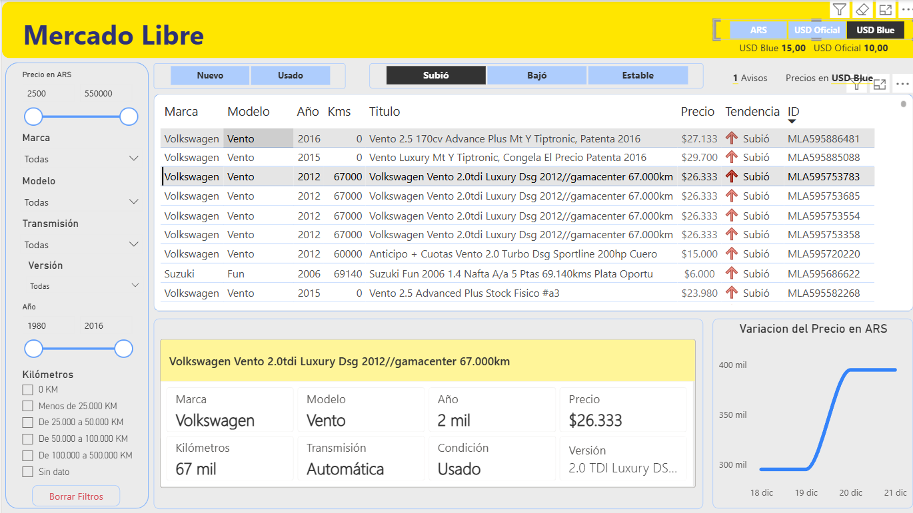
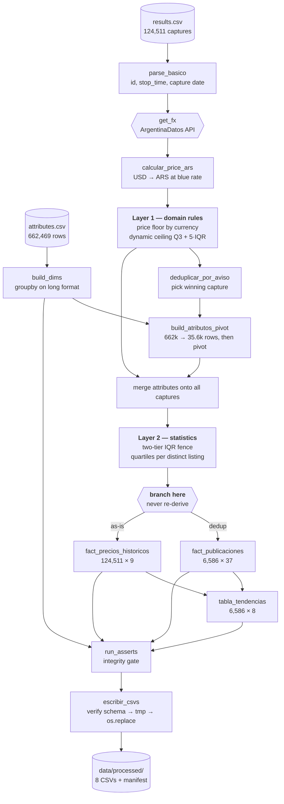
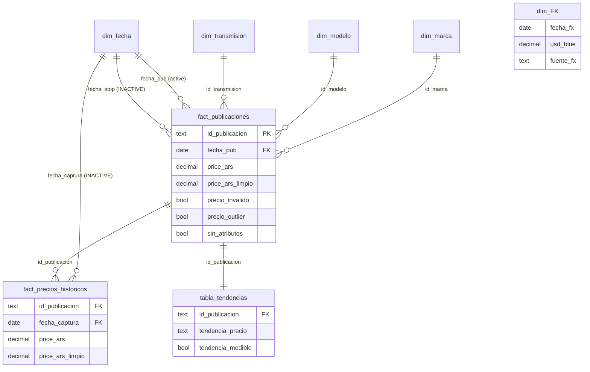

# MercadoLibre Used-Car Listings — ETL to Star Schema

[](https://github.com/santipigretti-ssp/challenge_bi/actions/workflows/tests.yml)

Python ETL that turns a raw scrape of MercadoLibre Argentina used-car listings into an
eight-table star schema for Power BI.

**The problem that shapes the whole design:** the raw file has 124,511 rows that look like
listings but aren't. They are *captures* — the scraper revisited the same listings daily for
73 days, so 124,511 rows are really 6,586 listings seen a median of 14 times each (max 70).
Treating a capture as a listing inflates every count by ~19x and makes every average
meaningless. Everything below follows from getting that grain right while keeping the price
history, which is where the interesting signal lives.

## The dashboard this feeds



Single page: listing explorer with cross-filtering, a currency toggle (ARS / USD official / USD
blue) driven by a disconnected selector table, and a price-history sparkline for the selected
listing. The `.pbix` itself is not in this repo — see
[Power BI](#power-bi) below.


| | |
|---|---|
| **Input** | 124,511 capture rows × 662,469 attribute rows (~100 MB, 2 CSVs) |
| **Output** | 8 CSVs + a manifest with a SHA-256 per table |
| **Listings** | 6,586 over 2015-10-10 → 2015-12-21 |
| **Runtime** | ~2 s on the full dataset |
| **Tests** | 172, running on a committed 1.5 MB fixture — no network, no 100 MB download |
| **Determinism** | Same input → byte-identical output, verified by test |

---

## Architecture



**The branch point is the most important decision in the repo.** `fact_precios_historicos` is
never derived from the deduplicated table — both fact tables branch from the same un-deduplicated
frame *after* all flags are computed. That means the price history keeps every capture (so trends
are computable) while the snapshot keeps one row per listing, and both agree on every flag
because the flags were computed once, upstream.

### Star schema



`dim_FX` is a one-row table, deliberately unrelated: a single exchange rate for the whole
period rather than a daily series.

---

## Quick start

```bash
python -m venv .venv
source .venv/bin/activate        # Windows: .venv\Scripts\activate
pip install -r requirements-dev.txt
pytest                            # 172 tests, ~10 s, no network
```

`requirements-dev.txt` is deliberately small (pandas, numpy, requests, pytest) so CI stays
fast. The notebook's dependencies live in `requirements-notebook.txt` and are only needed to
*regenerate* it — it is committed with its outputs rendered.

Tests run against `tests/fixtures/` — a stratified 1.5 MB sample committed to the repo. **A fresh
clone is fully testable**, which is why the fixture exists at all.

To run the pipeline on the real data you need the raw CSVs in `../CSVs/` (outside the repo — they
are ~100 MB and not redistributable):

```bash
python main.py
```

### Environment variables

| Variable | Default | Purpose |
|---|---|---|
| `ETL_DATASET` | `completo` | `fixture` points input and output at the committed sample |
| `ETL_FX_OFICIAL`, `ETL_FX_BLUE` | — | Pin the exchange rate and skip the API call entirely |
| `ETL_FX_FECHA` | last day of closed month | Date to record alongside a pinned rate |
| `ETL_FX_FALLBACK` | off | Allow the hardcoded fallback rate (see the audit table) |


### Troubleshooting: `FxError` / SSL handshake failures

If `python main.py` dies with `SSLEOFError` on `api.argentinadatos.com` while `curl` reaches
the same URL fine, the culprit is almost certainly **the CA bundle sitting on a synced drive**
(Google Drive, OneDrive, Dropbox). Python reads the file fine, but OpenSSL opens it through a
different path that those virtual filesystems mishandle — it stalls ~18 s and the handshake
dies. Copy the bundle somewhere local and point `requests` at it:

```bash
python -c "import certifi,shutil,pathlib; shutil.copy(certifi.where(), pathlib.Path.home()/'.certifi-cacert.pem')"
set REQUESTS_CA_BUNDLE=%USERPROFILE%\.certifi-cacert.pem   # Windows
export REQUESTS_CA_BUNDLE=$HOME/.certifi-cacert.pem          # bash
```

Diagnosed by elimination: raw `ssl` sockets and `curl` both succeed in 0.4 s (they use the
Windows certificate store), `verify=False` succeeds, and the *same bytes* copied off the synced
drive succeed — only the on-drive path fails.

If you just need the pipeline to run, pin the rate instead and skip the call: the run records
`fuente_fx = override` so the provenance stays honest.

```bash
ETL_FX_OFICIAL=10 ETL_FX_BLUE=15 ETL_FX_FECHA=2015-11-30 python main.py
```

---

## Data model

| Table | Grain | PK | Rows | Cols |
|---|---|---|---|---|
| `fact_publicaciones` | one row per listing (latest capture) | `id_publicacion` | 6,586 | 37 |
| `fact_precios_historicos` | one row per price capture | `id_publicacion` + `__KEY_results` | 124,511 | 9 |
| `tabla_tendencias` | one row per listing | `id_publicacion` | 6,586 | 8 |
| `dim_marca` / `dim_modelo` / `dim_transmision` | one row per value | `id_*` | 3 / 3 / 3 | 2 |
| `dim_fecha` | one row per day | `fecha` | 133 | 9 |
| `dim_FX` | the rate used this run | `fecha_fx` | 1 | 4 |

Full column-by-column reference: **[docs/DATA_DICTIONARY.md](docs/DATA_DICTIONARY.md)** (generated
from `etl/schemas.py`, so it cannot drift from the code).

---

## Design decisions

**Two outlier layers with different jobs.** Layer 1 is domain rules — a car does not cost 500
pesos, and a listing does not have 999,999,999 km. Layer 2 is statistics — a price that falls
outside the distribution of its own model-year. Keeping them separate means each flag answers
one question, and `price_invalido` never has to mean "weird" and "impossible" at the same time.

**The invalid-price ceiling is recomputed every run** as `Q3_global + 5·IQR_global` rather than
being a fixed peso amount, so inflation doesn't silently turn it into a no-op.

**`attributes.csv` (662k rows) is never pivoted whole.** Dimensions are built with a `groupby`
on the long format, and the pivot is filtered to the ~6k winning capture keys first — 662,469
rows down to 35,598 before reshaping.

**The minimum-sample gate counts distinct listings, not rows** — and so do the quartiles. 19
captures of the same car are one observation, not 19. Getting this right in the gate but wrong
in the estimator was one of the bugs found in the audit (see below).

**`_limpio` columns so no DAX measure needs a flag.** Alongside each raw value and its flags,
there is a `_limpio` copy that is null when the row is invalid (layer 1) **or** an outlier
(layer 2). Chart `price_ars_limpio` directly; never combine a raw value with one or two flags in
a measure. Raw values and flags are untouched, so nothing is lost.

**514 listings (7.8%) have no Marca/Modelo/Año/Km in any capture.** Not a deduplication
artifact — the data does not exist. They stay in the table with those fields null and
`sin_atributos = True`, keeping their price and trend.

---

## Data quality audit

The repo's first commit is the pipeline as originally delivered; every commit after it fixes one
finding, with the before/after measured on the full dataset. This is the part worth reading.

| # | Finding | Before | After |
|---|---|---|---|
| 1 | **`Estable` conflated "price didn't move" with "only seen once".** With one valid observation, `precio_ini == precio_fin` by construction, variation is 0, and the listing was reported as price-stable — the dashboard's headline KPI. | `Estable` 4,881 | `Estable` 4,281 + new `Observación única` 543 (8.2%), plus `tendencia_medible` so the 3-way split has an honest denominator (5,629) |
| 2 | **Listings without attributes could never be flagged as outliers.** Eligibility required `id_modelo` and `anio`, so the 514 `sin_atributos` listings bypassed layer 2 entirely — and they held the 3 most extreme prices in the dataset, which flowed straight into `price_ars_limpio`, the column documented as "chart this directly". | max `price_ars_limpio` among them **850,000 ARS** vs. 550,000 for listings *with* attributes | **490,000**. A global fence tier judges every layer-1-valid row against *some* reference; none escapes |
| 3 | **Output depended on the wall clock.** `anio_invalido` used `datetime.now().year + 1`, which feeds both IQR eligibility filters and from there `precio_outlier`, `km_outlier`, every `_limpio` column, `rango_km` and `tabla_tendencias`. | not reproducible | threshold derived from the data (`max(fecha_captura).year + 1`); a source-level test guards the regression |
| 4 | **An API failure produced byte-identical output.** `get_fx` caught every exception and fell back to `{oficial: 10.0, blue: 15.0}` — *exactly* what the live API returns for Nov-2015. A broken API, a schema change, or a renamed `venta` field was invisible, and the only evidence went to a log opened in `"w"` mode. | silent | hard `FxError` by default, fallback opt-in, payload validated field by field, `fuente_fx` recorded **in the model**, log appends |
| 5 | **Quartiles were computed over pooled captures.** The gate counted distinct listings to avoid pseudo-replication, then the estimator reintroduced it: a listing captured 70 times weighted Q1/Q3 70×. Degenerate for km, which is constant per listing. | 328 price outliers | 390. A unit test shows the failure mode: with pooled quartiles a dominant listing closes the fence around its own price, flags the *normal* listings, and lets the odd one through |
| 6 | **`python -O` skipped the entire integrity gate.** 11 bare `assert` statements ran before every write. | silently skipped | explicit `ValidationError`, failures accumulated and reported together, verified under `-O` in CI |
| 7 | **A latent crash in the attribute pivot.** `pd.to_numeric(df.get("anio"), …).astype("Int64")` raises `TypeError: data type 'Int64' not understood` when the column is absent — reachable on any subset lacking `Año` or `Kilómetros`. | crash | fixed schema via `reindex`, so all 9 attribute columns always exist; `.pivot()` duplicates are now deduplicated with a warning instead of raising |
| 8 | **A numeric key sorted as a string.** `__KEY_results`'s offset field takes 1-to-4-digit values, so `'800' > '1400'` lexicographically — the 08:00 capture would beat the 14:00 one. It drives both deduplication *and* `precio_ini`/`precio_fin`. | 10/10 real intra-day cases happened to resolve correctly | sorted on parsed integers; malformed keys raise instead of degrading silently |
| 9 | **Non-atomic writes.** A crash mid-write left partial CSVs that Power BI would consume without complaint. | partial files | all tables written to temporaries, then `os.replace`; schema and column order verified *before* touching the filesystem; `_manifest.json` records a SHA-256 per table |
| 10 | **Docs contradicted the code.** README and design doc both said `fact_publicaciones` has "35 columnas" while claiming to be "verified against each file's header". It has 36. | 35 claimed | the column list now lives in `etl/schemas.py`, the data dictionary is generated from it, and a test pins both |

| 11 | **The date dimension didn't cover `stop_time`.** The calendar spanned only the 73 capture days, so 44% of `stop_time` values had no row to join to — you couldn't slice "listings expiring by month" by the calendar at all. | 2,912 of 6,586 unmatched | 0. The calendar now runs to the last referenced date (133 days), `es_periodo_captura` marks the 73 real scrape days, and `fecha_stop` (a date, since Power BI can't relate a datetime to a date key) joins through an inactive relationship |

Two findings from the audit turned out to be **non-issues**, and are documented as such rather
than quietly dropped: the `Int64` cast does work (the CSV writes `2015`, not `2015.0` — the
`float64` you see on re-read is just pandas inference), and the string sort picks the right
capture in all 10 real intra-day duplicate cases.

One more thing the audit surfaced: **`"Más de 500.000 KM"` is unreachable** with this dataset.
No listing has km between 500,000 and the 800,000 validity cutoff (the highest valid value is
490,000), so that `rango_km` category is a legend entry that never appears.

---

## Reproducibility

Same input, byte-identical output. Three things make that true and checkable:

- No wall-clock reads in any transform module — enforced by a test that scans the source.
- `_manifest.json` records rows, columns, bytes and SHA-256 per table, plus the dataset and the
  exchange rate used.
- `test_dos_corridas_dan_el_mismo_sha256` runs the pipeline twice and compares digests.

The exchange rate is the only external dependency, and it can be pinned with
`ETL_FX_OFICIAL`/`ETL_FX_BLUE` — which is how CI runs, so CI never touches the network.

---

## Testing

172 tests. The ones worth knowing about:

- **Business rules**, parametrized on their boundaries: `categoria_km`, `clasificar_tendencia`,
  `calc_iqr_bounds`, the price floor per currency, `km_invalido` per band.
- **The two-tier IQR**, both halves of the gate: a normal price in a small group stays clean (the
  gate did not become "flagged by default") and an extreme one gets flagged.
- **The write contract**: wrong column order is rejected *without creating a file*; a simulated
  mid-write failure leaves the previous good CSVs untouched.
- **FX failure modes**: HTTP 500, timeout, renamed field, missing month, non-numeric rate — each
  must raise, not fall back.
- **`python -O`**: a dedicated CI step proves the integrity gate still fires with assertions off.
- **Integration** over the stratified fixture, asserting the fixture still exercises what it
  claims to. If someone regenerates it and loses layer-2 coverage, the tests fail instead of
  going green over a sample that proves nothing.

The fixture's strata and what each one covers: [tests/fixtures/README.md](tests/fixtures/README.md).

---

## Repo layout

```
etl/
  config.py           all tunables + dataset switch
  extract.py          read the two raw CSVs
  transform_results.py  dates, ARS normalization, layer 1 price, dedup, km ranges
  transform_attrs.py  dimensions + attribute pivot
  outliers.py         layer 1 km/year + layer 2 two-tier IQR
  tendencias.py       price trend per listing
  dimensions.py       calendar + FX dimension
  schemas.py          output column contract (single source of truth)
  validate.py         integrity gate + metrics report
  load.py             atomic write + manifest
  errors.py           ValidationError + column preconditions
main.py               the pipeline, read top to bottom
scripts/
  generar_fixture.py      builds the stratified test fixture
  generar_diccionario.py  builds the data dictionary from schemas.py
notebooks/
  diagnostico.ipynb   the analysis charts, rendered
docs/
  DATA_DICTIONARY.md                 generated reference
  Challenge_BI_Diseno_ETL_Python.md  original design document (Spanish)
```

Raw inputs are **not** in the repo: `etl/config.py` reads them from `../CSVs/`. There is no
`data/raw/` on purpose — an empty one next to that config would be misleading.

---

## Power BI

The report is built on the eight CSVs this pipeline writes. It is **not** committed here yet: a
`.pbix` is a binary blob that git cannot diff, and it grows the repo by its full size on every
save. The useful artifact is the **PBIP** project format, which stores the semantic model and the
report definition as TMDL/JSON text — measures, relationships and column types all readable and
diffable. Saving it that way (`File → Save as → Power BI project`) is the intended next step.

One caveat when that lands: PBIP stores **absolute paths** to the CSV files, so a clone cannot
refresh without editing them. A Power Query parameter for the folder is the fix.


---

## Known limitations

- **38% of listings are re-posts of the same car, and the pipeline does not collapse them.**
  713 groups share an identical title, price, year and mileage across different listing ids —
  2,527 listings in all. The largest is 55 copies of one 0 km Vento, posted under near-sequential
  ids over two weeks: a dealer bulk-reposting inventory. Real inventory is closer to 4,772 cars
  than 6,586 listings, and the bias is not neutral — dealers re-post more than private sellers, so
  the average price reads **235,943 over listings vs 212,598 over distinct cars (-10%)** and mean
  mileage **70,312 vs 81,956 (+17%)**. It is the same class of problem as captures-vs-listings,
  one level up. Left unfixed deliberately: collapsing them needs a judgment call about what counts
  as "the same car" without seller data (`seller_contact.csv` was out of scope), and a wrong
  grouping key would silently merge genuinely different listings. Anything counting inventory off
  `fact_publicaciones` should be read with this in mind.
- **Only 3 makes and 3 models.** That's the dataset, not a filter: the scrape covers a single
  MercadoLibre category and that's what was in it.
- **`accepts_mercadopago` carries no information** — `False` in all 124,511 source rows. Kept for
  source fidelity, and surfaced by a zero-variance detector on every run rather than left as an
  undocumented passenger.
- **`dim_FX` is one rate, not a daily series.** Fine for a 73-day window; wrong for a longer one.
- **The `.pbix` and DAX measures are not in this repo.** This is the data layer.

---

## A note on language

This README is in English. The code, column names, log messages and the original design document
are in Spanish, matching the business domain (Argentine used-car market) and the specification
this was built against. Renaming them to look tidier in a portfolio would have made the code
harder to read against its own spec.
